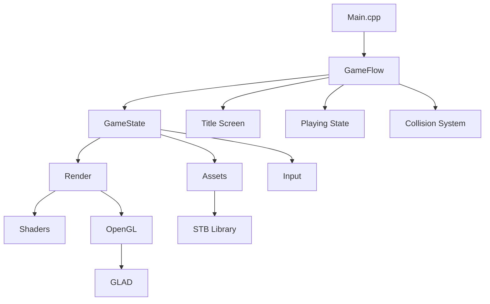
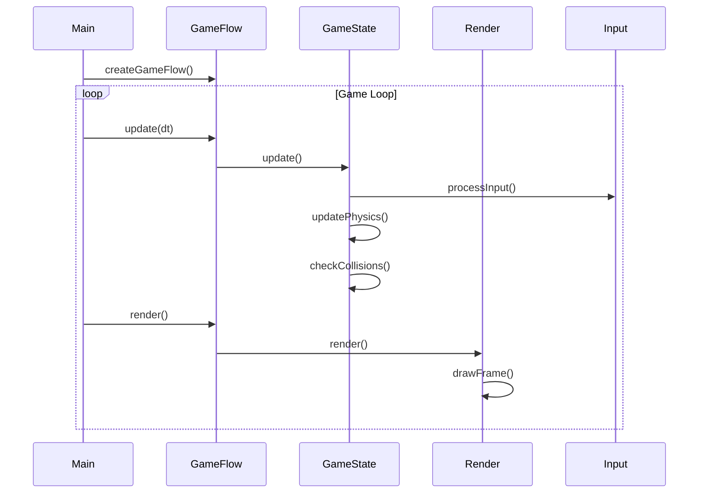
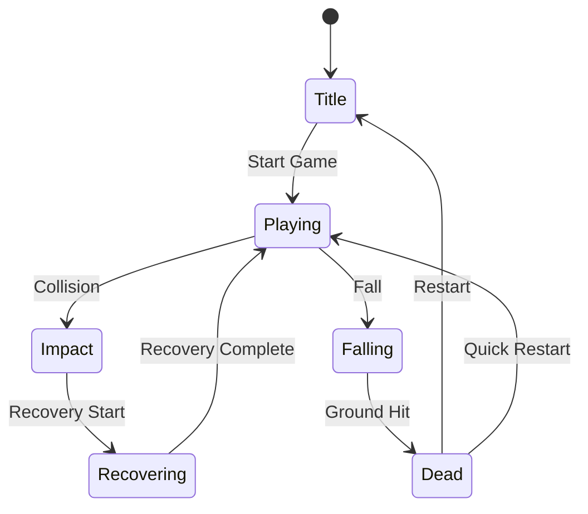

# FlapHero - Документация проекта

## Обзор

FlapHero - это игра в стиле Flappy Bird, написанная на C++ с использованием OpenGL. Проект демонстрирует современную архитектуру игрового движка с использованием фреймворка Plywood.

## 1. Структура проекта

```
FlapHero/
├── glad/                          # OpenGL Loader (GLAD)
│   ├── glad.modules.cpp
│   ├── include/
│   │   ├── glad/glad.h
│   │   └── KHR/khrplatform.h
│   └── src/glad.c
├── glfwFlap/                      # Основное приложение
│   ├── glfwFlap.modules.cpp
│   └── Main.cpp                   # Точка входа
├── flapGame/                      # Игровой движок
│   ├── flapGame.modules.cpp
│   └── flapGame/
│       ├── Core.h                 # Основные включения
│       ├── Public.h               # Публичный API
│       ├── GameFlow.h             # Управление игровым циклом
│       ├── GameState.h            # Состояние игры
│       ├── GameFlow.cpp           # Реализация игрового цикла
│       ├── GameState.cpp          # Реализация состояния игры
│       ├── Assets.h               # Управление ресурсами
│       ├── Assets.cpp             # Загрузка ресурсов
│       ├── Render.cpp             # Рендеринг
│       ├── Shaders.h              # Шейдеры
│       ├── Shaders.cpp            # Реализация шейдеров
│       ├── GLHelpers.h            # OpenGL утилиты
│       ├── GLHelpers.cpp          # OpenGL функции
│       ├── Text.h                 # Текстовый рендеринг
│       ├── Text.cpp               # Реализация текста
│       ├── TitleScreen.h          # Экран заголовка
│       ├── TitleScreen.cpp        # Реализация заголовка
│       ├── Button.h               # Кнопки UI
│       ├── Button.cpp             # Реализация кнопок
│       ├── Collision.h            # Система коллизий
│       ├── Collision.cpp          # Реализация коллизий
│       ├── Puffs.h                # Эффекты частиц
│       ├── Puffs.cpp              # Реализация частиц
│       ├── Sweat.h                # Эффект пота
│       ├── Sweat.cpp              # Реализация пота
│       ├── Tongue.h               # Язык птицы
│       ├── Tongue.cpp             # Реализация языка
│       ├── LoadPNG.h              # Загрузка PNG
│       ├── LoadPNG.cpp            # Реализация загрузки
│       ├── DrawContext.h          # Контекст рисования
│       ├── DrawContext.cpp        # Реализация контекста
│       ├── VertexFormats.h        # Форматы вершин
│       └── stb/                   # Библиотека STB
│           ├── stb_image.h        # Загрузка изображений
│           ├── stb_rect_pack.h    # Упаковка прямоугольников
│           └── stb_truetype.h     # Работа со шрифтами
└── Triangle/                      # Демо-приложение
    ├── Triangle.modules.cpp
    └── Main.cpp                   # Демо треугольника
```

## 2. Описание файлов

### 2.1 Точка входа

#### `glfwFlap/Main.cpp`
**Назначение:** Главная точка входа в приложение
**Ключевые функции:**
- `main()` - инициализация GLFW, OpenGL и игрового движка
- `key_callback()` - обработка клавиатуры
- `mousebutton_callback()` - обработка мыши
- `error_callback()` - обработка ошибок GLFW

**Связи:** Использует `flapGame/Public.h` для доступа к игровому API

### 2.2 Игровой движок

#### `flapGame/flapGame/Public.h`
**Назначение:** Публичный API игрового движка
**Ключевые функции:**
- `init()` - инициализация движка
- `createGameFlow()` - создание игрового потока
- `update()` - обновление игровой логики
- `render()` - рендеринг
- `doInput()` - обработка ввода

#### `flapGame/flapGame/GameFlow.h`
**Назначение:** Управление игровым циклом и состояниями
**Ключевые классы:**
- `GameFlow` - основной класс управления игрой
- `Transition` - система переходов между состояниями

**Связи:** Наследует от `GameState::OuterContext`

#### `flapGame/flapGame/GameState.h`
**Назначение:** Определение игровых состояний и объектов
**Ключевые классы:**
- `GameState` - основное состояние игры
- `Obstacle` - базовый класс препятствий
- `Pipe` - трубы как препятствия
- `AnimState` - перечисление состояний анимации

**Состояния игры:**
- `Title` - экран заголовка
- `Playing` - игровой процесс
- `Impact` - столкновение
- `Recovering` - восстановление
- `Falling` - падение
- `Dead` - смерть

#### `flapGame/flapGame/Assets.h`
**Назначение:** Управление игровыми ресурсами
**Ключевые структуры:**
- `Assets` - основной класс ресурсов
- `BirdAnimData` - данные анимации птицы
- `DrawGroup` - группы для рендеринга
- `Bone` - кости скелета

#### `flapGame/flapGame/Render.cpp`
**Назначение:** Система рендеринга
**Ключевые функции:**
- Рендеринг игровых объектов
- Управление камерой
- Эффекты постобработки

#### `flapGame/flapGame/Shaders.h`
**Назначение:** Управление шейдерами OpenGL
**Ключевые классы:**
- `UberShader` - универсальный шейдер
- `ShaderProgram` - программа шейдеров

### 2.3 Библиотеки

#### `glad/`
**Назначение:** OpenGL Loader (GLAD)
**Файлы:**
- `glad.h` - заголовочные файлы OpenGL
- `glad.c` - реализация загрузчика
- `khrplatform.h` - платформо-зависимые типы

#### `stb/`
**Назначение:** Библиотека STB для работы с медиа
**Файлы:**
- `stb_image.h` - загрузка изображений
- `stb_truetype.h` - работа со шрифтами
- `stb_rect_pack.h` - упаковка прямоугольников

### 2.4 Демо-приложение

#### `Triangle/Main.cpp`
**Назначение:** Демонстрационное приложение с вращающимся треугольником
**Функции:**
- Демонстрация базового OpenGL рендеринга
- Простые шейдеры
- Обработка ввода

## 3. Архитектура проекта

### 3.1 Общая структура



### 3.2 Потоки данных



### 3.3 Система состояний



## 4. Библиотеки/фреймворки

### 4.1 OpenGL (GLAD + GLFW)
**Назначение:** Графический API
**Где используются:**
- `glfwFlap/Main.cpp` - инициализация окна
- `flapGame/flapGame/Render.cpp` - рендеринг
- `flapGame/flapGame/Shaders.cpp` - шейдеры

### 4.2 Plywood Framework
**Назначение:** C++ фреймворк для разработки
**Где используются:**
- Все файлы проекта используют `ply-runtime` и `ply-math`
- Система модулей через `.modules.cpp` файлы

### 4.3 STB Library
**Назначение:** Загрузка медиа-файлов
**Где используются:**
- `flapGame/flapGame/Assets.cpp` - загрузка текстур
- `flapGame/flapGame/Text.cpp` - работа со шрифтами

### 4.4 SoLoud
**Назначение:** Аудио библиотека
**Где используются:**
- `flapGame/flapGame/Core.h` - включение
- `flapGame/flapGame/GameFlow.cpp` - воспроизведение музыки

## 5. Точка входа и запуск

### 5.1 Последовательность запуска

1. **Инициализация GLFW** (`glfwFlap/Main.cpp:main()`)
   - Настройка OpenGL контекста
   - Создание окна
   - Установка callbacks

2. **Инициализация OpenGL**
   - Загрузка GLAD
   - Создание VAO
   - Настройка debug callbacks

3. **Инициализация игры** (`flap::init()`)
   - Загрузка ресурсов
   - Инициализация аудио
   - Создание GameFlow

4. **Главный цикл**
   - Обработка ввода
   - Обновление игры (`update()`)
   - Рендеринг (`render()`)
   - Обмен буферов

### 5.2 Управление

- **Пробел** - взмах крыльями
- **R** - перезагрузка ресурсов
- **B** - кнопка "Назад"
- **P** - пауза
- **Escape** - выход

## 6. Архитектурные особенности

### 6.1 Система состояний
- Использование паттерна State Machine
- Плавные переходы между состояниями
- Разделение логики по состояниям

### 6.2 Компонентная архитектура
- Разделение на логические модули
- Слабая связанность между компонентами
- Четкие интерфейсы

### 6.3 Система ресурсов
- Централизованное управление ресурсами
- Автоматическая загрузка и выгрузка
- Кэширование ресурсов

### 6.4 Рендеринг
- Современный OpenGL (Core Profile)
- Система шейдеров
- Эффекты постобработки

### 6.5 Причины выбора архитектуры

1. **Модульность** - легкое тестирование и поддержка
2. **Производительность** - оптимизированный рендеринг
3. **Расширяемость** - легко добавлять новые функции
4. **Кроссплатформенность** - использование стандартных библиотек

## 7. Компиляция и сборка

### 7.1 Зависимости
- C++17 компилятор
- OpenGL 3.3+
- GLFW 3.x
- Plywood Framework
- SoLoud (для аудио)

### 7.2 Структура сборки
- Используется система модулей Plywood
- `.modules.cpp` файлы определяют зависимости
- Автоматическая генерация кода через `ply make`

### 7.3 Платформы
- Windows (основная)
- Linux (теоретически поддерживается)
- macOS (требует адаптации)

## 8. Заключение

FlapHero демонстрирует современный подход к разработке игр на C++ с использованием:
- Чистой архитектуры
- Современных графических API
- Эффективной системы управления ресурсами
- Модульной структуры кода

Проект служит отличным примером для изучения игровой разработки и архитектуры приложений.

---

Автор: legenda  
Telegram: [@LEGENDA_SD](https://t.me/LEGENDA_SD)
